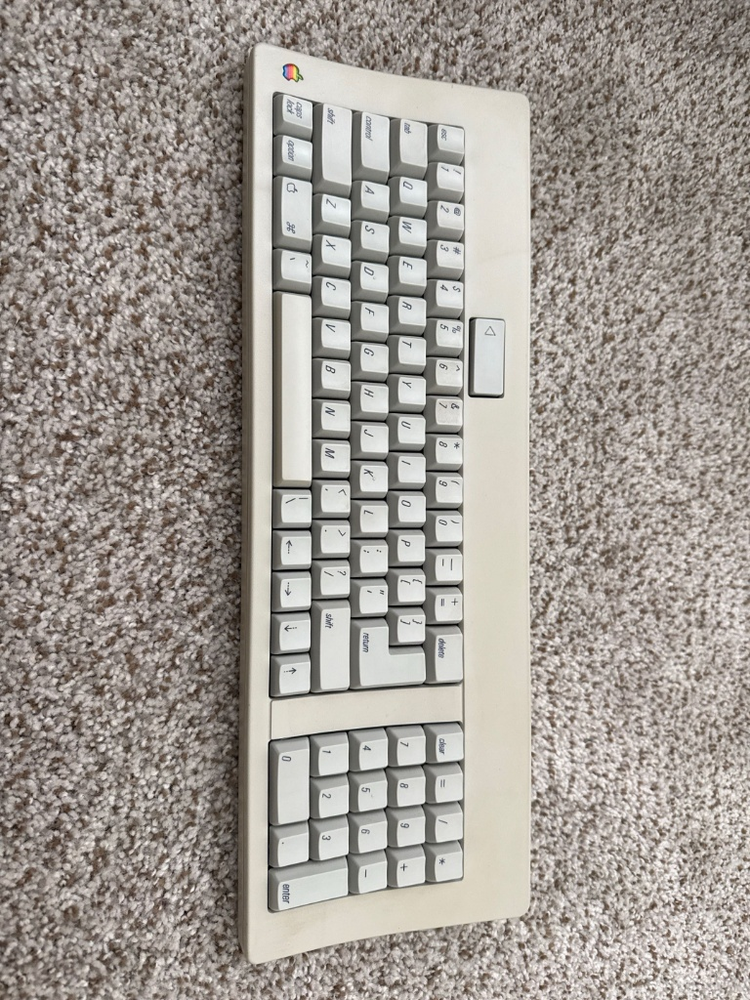
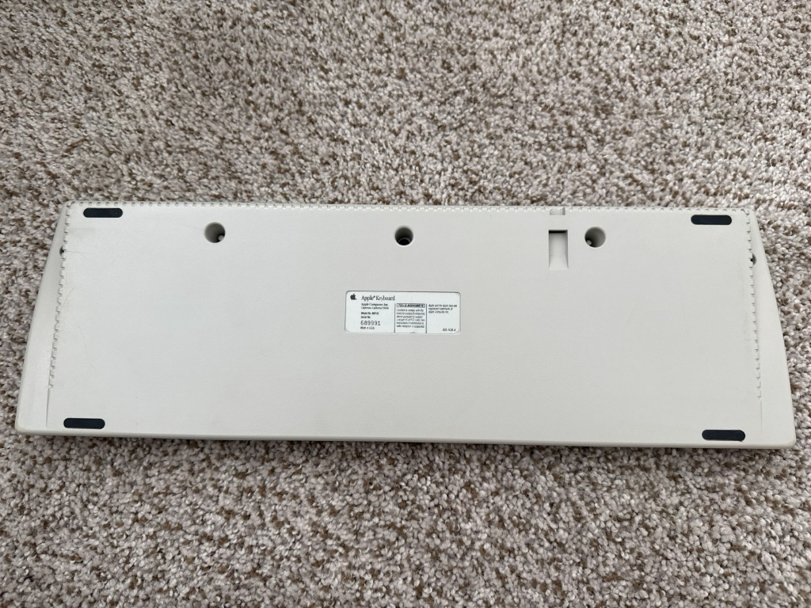
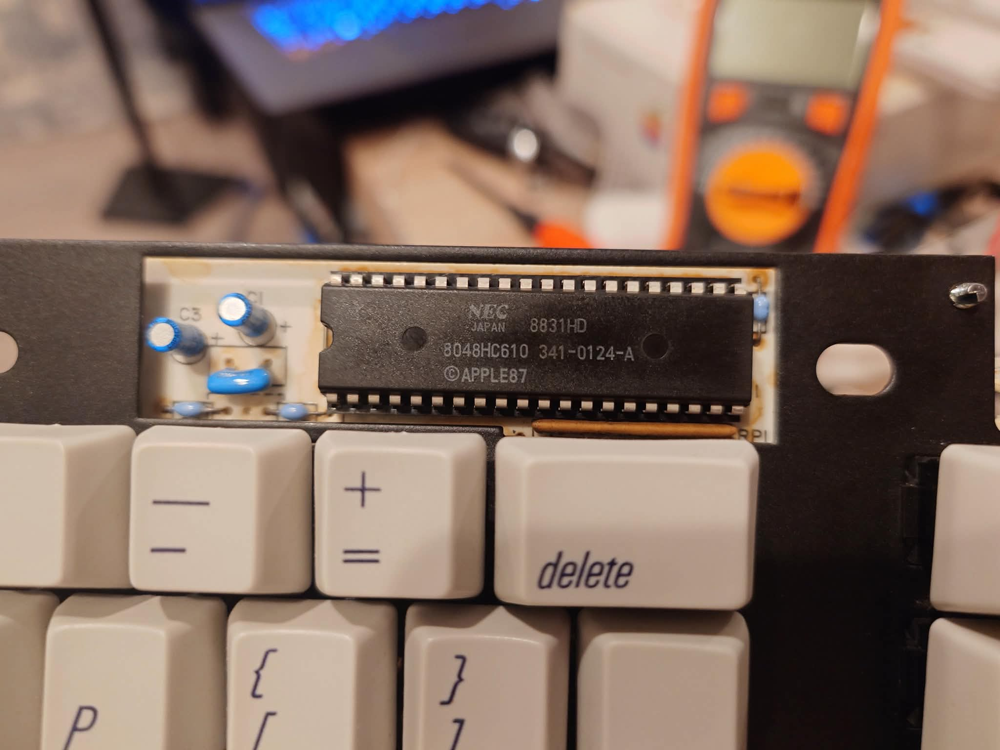
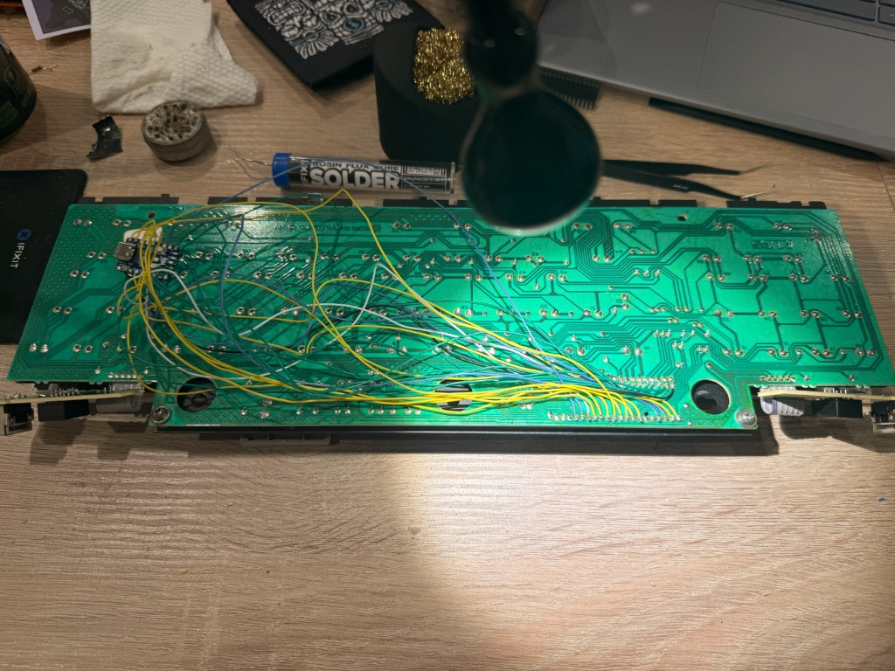
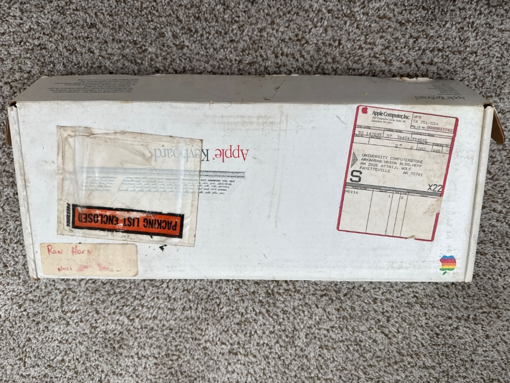
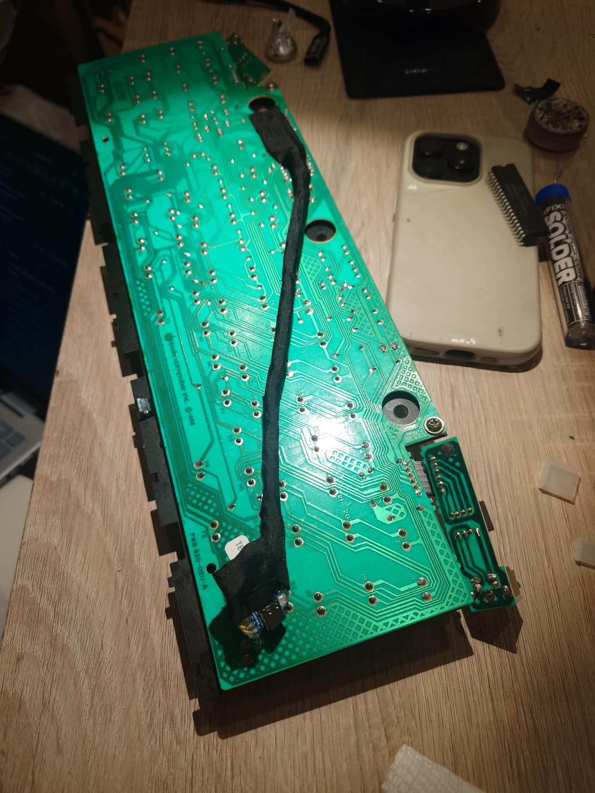

# Apple M0116 Conversion Gallery

| Keyboard Overview | Case & Label |
| :---: | :---: |
|  |  |

| Original PCB | Socket Mod Area |
| :---: | :---: |
|  |  |

| RP2040-Zero Harness | Socket Solder Points |
| :---: | :---: |
|  |  |

| Soldering in Progress | Full Harness Routing |
| :---: | :---: |
|  |  |

| Original Box | Finished Assembly |
| :---: | :---: |
|  |  |
